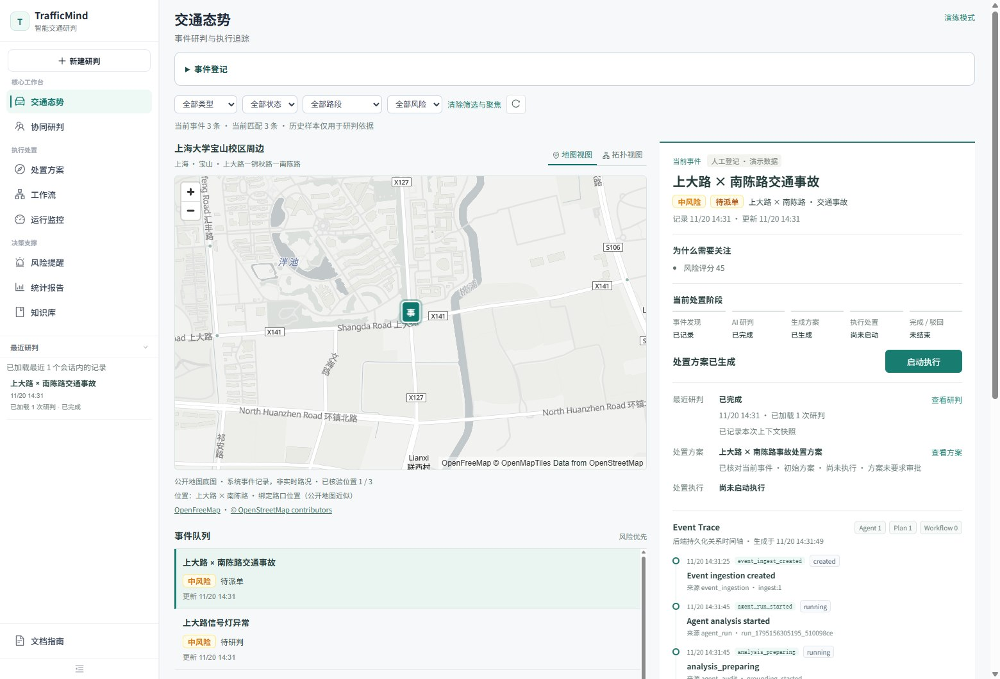
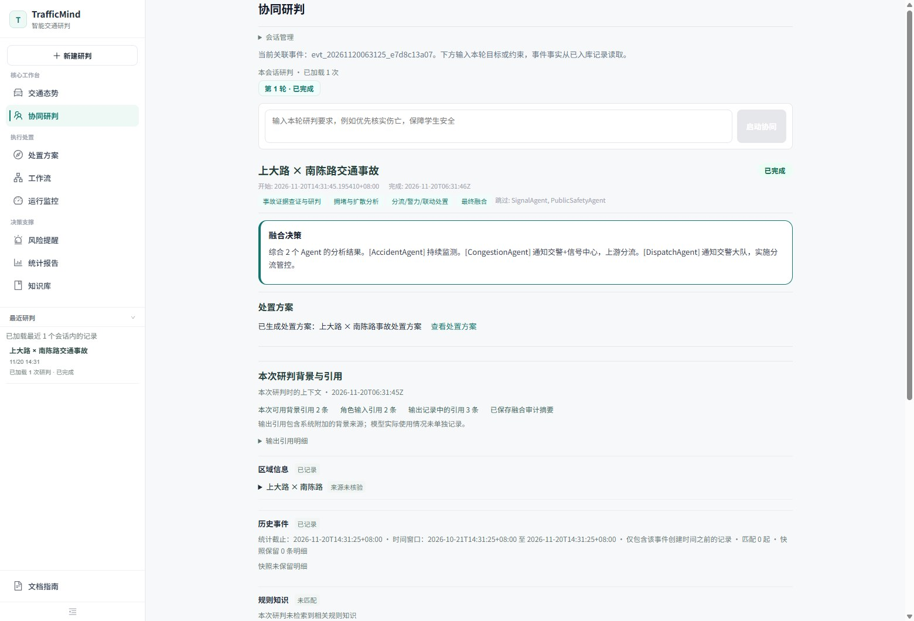
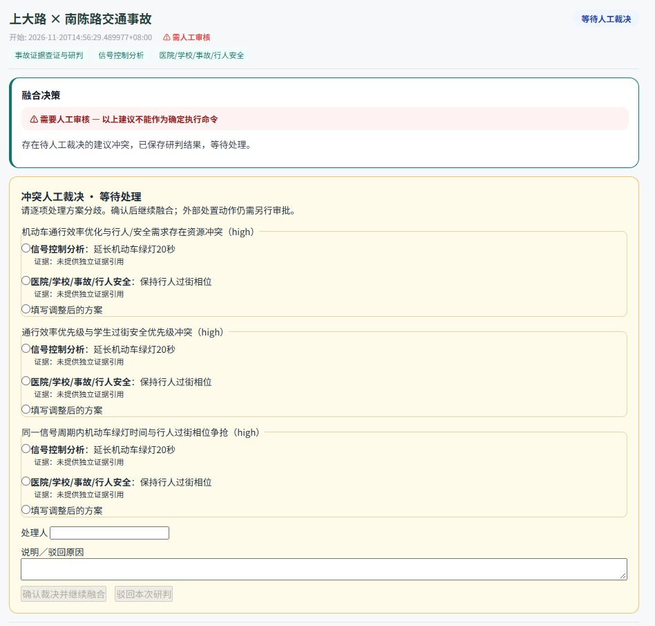
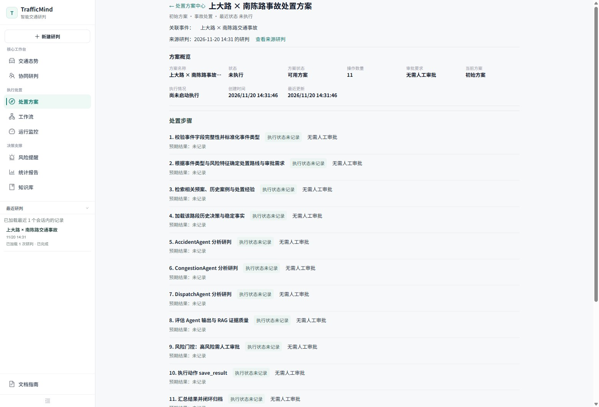
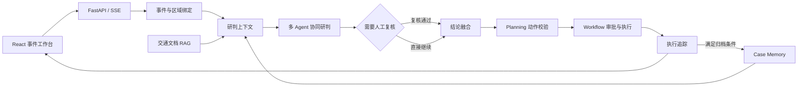

# TrafficMind Agent

**基于 Multi-Agent 的城市交通智能研判与辅助处置系统。**

TrafficMind 面向交通事故、道路拥堵等城市交通事件，融合道路交通信息、法规知识和历史处置案例，支持多角色协同分析、处置方案生成与人工审批后的受控执行。系统记录研判依据、审批决定和执行结果，形成可追溯、可复用的交通事件处置闭环。



## 核心能力

### Multi-Agent 协同研判

事件进入研判后，Router 根据事件类型和现场事实，按预定义规则选择事故、拥堵、信号和公共安全等角色。中央 Orchestrator 使用 `CollaborationTaskGraph` 管理任务依赖，通过共享 Run State 传递结构化结果，并为不同角色投影所需的事件、证据和记忆字段。当前就绪任务依次执行，领域角色给出研判后，由 Dispatch 汇总处置建议，再进入冲突检测、按需仲裁和 Fusion。

事故 Agent 在 `llm_tools` 模式下可以多轮调用只读工具，按需查证绑定道路、相关规则或历史案例。运行时通过工具白名单、参数校验和调用预算约束查询，并用 `EvidenceLedger` 记录本轮可引用的证据。需要人工裁决时，系统保存领域角色结果和冲突检查点，将运行置为 `awaiting_review`。允许继续的裁决通过复核版本与来源校验后，系统从检查点恢复融合。

### RAG 检索与案例记忆复用

`GroundedEventContext` 将当前事件的道路绑定、同区域历史、法规与预案证据、历史处置案例组装为研判快照。文档检索按区域、事件类型与生效时间筛选证据，使用 Qwen3 Embedding 与 Chroma 做 Dense 召回，结合 SQLite FTS 的稀疏召回及 Python BM25 回退。候选结果经 RRF 融合与 Rerank 重排序后，保留文档、分块和来源引用，供角色查证与结果回看。

符合归档条件的终态 Workflow 会将事件事实、研判、方案、审批与执行结果沉淀为结构化 Case。Case Memory 在 SQLite 中按区域、事件类型、时间与质量状态筛选，并使用已记录的处置反馈更新案例评价。后续研判可回查参考案例的来源及执行记录。

在包含 **24 条合成查询**的相似预案压力集上，文档级 **Recall@5 从 79.17% 提升到 97.92%**，对比的是 Dense 单路与 Dense + BM25 + RRF + Rerank 的完整检索配置。

#### Grounding 与 Case Memory

四类上下文按各自的条件筛选，随协同研判保存为一份快照。

| 上下文 | 提供什么 | 筛选条件 |
| --- | --- | --- |
| Regional | 区域、道路、路口及附近设施 | 使用当前有效且已解析的标准位置绑定 |
| History | 同区域历史事件、统计与来源引用 | 历史记录的 `createdAt` 严格早于当前事件 |
| Knowledge | 法规、标准、处置预案和区域公开资料 | 满足适用区域、事件类型和生效时间条件 |
| Case Memory | 历史处置步骤、审批决定、执行结果与反馈 | 同区域、同事件类型，案例完成时间早于查询时点，质量状态符合召回条件 |

案例以结构化业务字段和来源标识归档。来源关系齐全时，可沿 `Case → Workflow → Plan → Agent Run → Event` 回查。后端支持按 `caseId` 查看归档详情，并按 `eventId` 获取可用于本次研判的案例上下文。[Case Memory API](backend/case_memory/api.py)

### Planning + Workflow 受控执行

`AgentPlanningAdapter` 将研判中的 `proposed_actions` 转为候选步骤，并关联源事件与研判记录。确定性 Planner 通过 Action Registry 检查能力白名单、参数 Schema 与执行前置条件，将通过校验的候选动作物化为可运行的 Plan 和 Workflow。

Workflow 在高风险动作前核验人工审批，按动作实例保存执行状态与幂等标识。执行恢复会读取已持久化的运行和动作记录。对外部结果未知的动作，保留待核对状态并等待对账或人工确认。处置方案和工作流页面可分别查看动作步骤、审批决定与运行轨迹。

### Agent 评测与可靠性优化

Evaluation Runner 在隔离数据环境中运行合成业务用例，支持脚本化模型、在线模型和模型 I/O 回放。规则断言检查工具调用、引用、审批及 Workflow 状态，LLM-as-a-Judge 按研判质量、证据支持度和处置可行性评分。评测产出单用例记录与批次汇总，配合 Event Trace 回查工具、模型输出和执行状态。

针对输出格式或字段错误，事故 Agent 的可配置纠错流程将结构化校验反馈交给模型。工具参数错误会返回受控的 Schema 提示，可恢复的只读查询故障允许在原预算内重试。合成故障注入评测中，格式和字段异常恢复 **114/120** 次，工具参数及瞬态查询异常恢复 **16/18** 次，合计 **130/138（94.20%）**。恢复成功要求原任务断言、证据和动作校验均通过。

## 演示截图

演示选择**上海大学宝山校区周边 Pilot** 中上大路与南陈路路口的一起合成事故。地图使用公开路网资料，截图中的事故和处置记录来自本地验证。

1. 在「交通态势」登记事件，确认事件类型、地点及已知现场事实。
2. 打开「协同研判」，查看参与研判的角色、融合结论与证据引用。
3. 从研判生成处置方案，通过关联事件和来源研判核对方案，并在启动执行后查看 Workflow 的审批与执行状态。

## 前端页面截图

### 协同研判

页面展示同一事件的研判轮次、领域角色、融合建议和已记录的引用。



### 研判冲突人工裁决

在上大路与南陈路路口的合成事故用例中，预设的信号和公共安全角色意见分别建议延长机动车绿灯和保留行人过街相位。系统暂停融合，等待人工选择、调整或驳回方案。



### 处置方案

页面通过关联事件与来源研判定位计划生成依据。截图展示已生成、待执行的初始方案及其步骤。



## 系统架构



一次业务链路通过持久化标识串联 `Event → Agent Run → Plan → Workflow Run`。前端用 FastAPI 接口读取对应记录，并通过 SSE 展示协同研判过程。研判复核处理角色之间的结论冲突，执行审批绑定计划中的动作，两种决定分别写入各自的运行记录。

| 模块 | 实现与入口 |
| --- | --- |
| Agent 协同 | 角色路由、任务图和复核续接。[协同编排](backend/agent/collaboration/) · [事故 Agent 运行时](backend/agent/llm_accident/) |
| 决策上下文 | 事件上下文、文档检索和结构化案例。[Grounding](backend/grounding/) · [RAG V2](backend/rag/v2/) · [Case Memory](backend/case_memory/) |
| 计划与执行 | 规划校验、审批、动作状态和恢复。[Planning](backend/planning/) · [Workflow](backend/workflow/) |
| 评测与追踪 | 用例运行、规则校验、语义评分与事件轨迹。[Evaluation V2](backend/evaluation/v2/) · [Observability](backend/observability/) |

## 安全执行机制

- **查证与执行。** 事故 Agent 在多轮 Tool Calling 中使用与当前事件绑定的只读工具。候选处置建议由 Planning 校验后交给 Workflow 执行。
- **核验方案来源。** `AgentPlanningAdapter` 校验事件、会话与协同运行的关联，读取持久化的研判结果和 Grounding。经历人工复核的研判使用复核后的结果生成方案。
- **限制可执行动作。** Action Registry、参数 Schema 和执行前置条件共同约束动作。只有已注册、参数合法并满足执行条件的动作可以进入执行。
- **审批与恢复。** 高风险动作需要通过人工审批。动作实例级审批以步骤标识绑定执行目标。Workflow 持久化运行、审批及动作状态，并通过幂等标识识别同一动作的重复触发。外部结果未知的动作进入待核对状态。
- **追溯业务关系。** 页面以持久化的 `eventId`、`agentRunId`、`planId`、`workflowRunId` 跳转。Event Trace 汇集研判、计划、审批和动作记录，可据此核对执行状态。

## 数据真实性说明

| 数据 | 来源或类型 | 使用范围 |
| --- | --- | --- |
| 上海大学宝山 Pilot 区域 | 公开的道路、路口与校方地址资料 | 覆盖校区周边 6 条道路、7 个路口和 3 处地点 |
| 上海 Pilot 演示截图 | 人工登记的合成事故 | 展示事件定位、协同研判和处置方案生成 |
| 钱塘 Pilot 区域与知识 | 公开核验的区域资料和法规、标准、规划摘要 | 用于有限路网的区域绑定和规则检索 |
| 钱塘公开历史 | 公开报道或文书支持的事件级事实 | 用于历史查询和事件回放 |
| 钱塘合成历史与当前事件 | 合成历史池和固定验证事件 | 用于覆盖、检索和研判处置链路验证 |
| 闭环案例 | 合成事件执行记录或公开事件的系统回放 | 保留系统内的研判、审批与终态。外部结果由实际反馈或证据确认 |
| 本地脚本化评测 | 合成业务用例、固定模型响应和隔离动作适配器 | 验证链路、规则和状态流转。在线模型评测有独立运行模式 |

区域数据与时间筛选规则可查阅对应资料。[上海大学宝山区域资料](backend/data/pilot_regions/shu_baoshan_001/README.md) · [钱塘数据来源说明](docs/data-provenance.md)

### 公开历史隐私

公开历史包只保留事件类型、时间精度、简化地点、参与者类别、事件影响及最小来源信息。姓名、车牌、住址、医疗、保险与赔偿等个人信息排除在样例字段之外，原始裁判文书页面也排除在项目数据包之外。

### 地图边界

前端用 MapLibre GL JS 渲染地图，默认采用 OpenFreeMap Positron，加载失败时可回退到 OpenStreetMap 栅格底图，并展示 OpenStreetMap contributors 等来源署名。事件位置由后端区域绑定决定。地图仅为已绑定到核验路口且坐标一致的事件生成标记，其他事件继续在工作台列表中展示。底图可用性取决于公共服务提供方。

## 技术栈

| 层级 | 实际技术 |
| --- | --- |
| 后端与接口 | Python 3、FastAPI、Uvicorn、Pydantic、SSE |
| Agent 与模型 | LangGraph 事件分析图、自有 TaskGraph DAG、OpenAI 兼容模型接口、多轮 Tool Calling |
| 检索与持久化 | Qwen3 Embedding、Qwen3 Reranker、Chroma、SQLite、SQLite FTS / Python BM25 |
| 计划与执行 | 确定性 Planner、Action Registry、Workflow Runtime、人工审批 |
| 前端与地图 | React 18、TypeScript、Ant Design、ECharts、Vite、MapLibre GL JS |
| 测试与评测 | pytest、Node.js Test Runner、TypeScript 构建、Evaluation Runner |

## 执行指令

从仓库根目录执行。以下为 Windows PowerShell 命令。

```powershell
# 安装依赖
python -m venv backend/.venv
.\backend\.venv\Scripts\python.exe -m pip install -r backend/requirements.txt
npm.cmd ci --prefix frontend

# 终端一 · 后端
.\backend\.venv\Scripts\python.exe -m uvicorn backend.app:app --host 127.0.0.1 --port 8000

# 终端二 · 前端
$env:VITE_PROXY_TARGET = 'http://127.0.0.1:8000'
npm.cmd --prefix frontend run dev
```

打开 [TrafficMind 工作台](http://127.0.0.1:5173) 或 [API 文档](http://127.0.0.1:8000/docs)。模型配置见 [环境变量示例](backend/.env.example)，演示路网见 [上海大学宝山区域资料](backend/data/pilot_regions/shu_baoshan_001/README.md)。

### 本地评测

启动服务之外，也可以在仓库根目录运行两条脚本化评测用例，分别验证只读工具查证和批准后重复触发的执行约束。

```powershell
.\backend\.venv\Scripts\python.exe -m backend.evaluation.v2.runner --modes llm_tools --transport scripted --case E01 --case E02
```

运行器会写出单用例 `record.json` 和批次 `summary.json`。[Smoke 用例定义](backend/evaluation_data/trafficmind_eval_v2_smoke.json)

## 已知限制

- **运行范围。** 当前版本面向本地演练和研发验证。实时生产交通事件流、信号设施和交管派单系统的对接属于独立集成工作。
- **覆盖与外部效果。** Pilot 仅覆盖文档列出的局部道路和样例事件。检索实验衡量文档召回，故障注入评测衡量指定异常的恢复情况。实际交通效果需独立采集外部结果验证。
- **案例追溯。** 当前可通过 Case Memory API 按案例和事件查询。前端可沿事件、研判、方案与 Workflow 记录查看业务链路。
- **部署前提。** 当前启动方式面向本地单用户。生产部署的鉴权、权限管理、多租户隔离和并发容量需单独设计和验证。

## 仓库结构

```text
backend/
  agent/              角色、协同任务图和事故 Agent 运行时
  regional/           区域数据导入与事件位置绑定
  grounding/          研判上下文与证据快照
  rag/                文档检索与重排序
  case_memory/        结构化案例与反馈
  planning/           候选动作校验和处置方案
  workflow/           审批、执行、状态持久化与恢复
  observability/      事件轨迹与运行监控
  evaluation/         评测运行、规则断言与语义评分
  evaluation_data/    评测用例
  data/               区域、知识和验证数据包
frontend/
  src/                事件工作台、研判、计划、工作流与地图
  tests/              前端行为测试
scripts/              Demo 启动和本地验证脚本
docs/                 架构、数据来源、接口资料和演示截图
```

运行中的 API 文档可通过 `/docs` 查看。仓库也提供 [API 请求示例](docs/api_examples.md) 与 [OpenAPI 快照](docs/openapi.json)。
